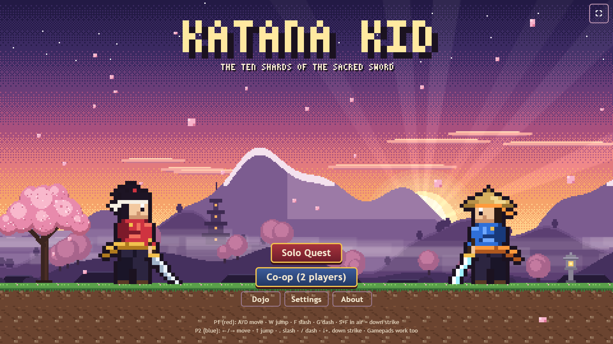

# Katana Kid

A pixel-art samurai platformer that runs in the browser. Play it at **https://katanakid.netlify.app/**



Luqman came up with the idea: the hero, the enemies, the worlds and the Red Oni boss.

Built by Waqas Bajwa with AI-assisted development. I designed the game, played and tested every build myself, and had the AI fix the issues I found, such as character movement, gameplay and performance.

## Play

- **Solo Quest**: ten levels, from Cherry Blossom Valley to the Oni Fortress, with a boss fight at the end.
- **Co-op**: two players on one keyboard, or with gamepads.
- **Dojo**: customise each samurai's name, armour, sash, look and sword.

| | Player 1 (red) | Player 2 (blue) |
|---|---|---|
| Move | A / D | ← / → |
| Jump | W | ↑ |
| Slash | F | . |
| Dash | G | / |
| Down strike (in the air) | S + F | ↓ + . |

Gamepads work for both players. On phones and tablets, on-screen touch controls appear automatically. M toggles music.

## What is in it

- Ten named levels: Cherry Blossom Valley, Misty Bamboo Grove, Thunder Peaks, Lantern River, Ember Volcano, Frozen Shrine, Moonlit Castle, Storm Coast, Shadow Marsh and Oni Fortress.
- Seven enemy types (soldiers, archers, shield bearers, ninjas, bandit frogs, crows and lantern spooks) and the Red Oni boss, with slam, charge and throw attacks.
- Levels are generated from a seed, so the same level number always builds the same layout.
- All art is drawn in code onto a canvas, and the sound is generated with the Web Audio API. There are no image or audio files.
- Enemies, projectiles and pickups come from fixed-size object pools, so the game does not create new objects every frame.
- Settings for music and sound volume, screen shake, flashes, touch controls and a low graphics mode. Progress and settings are saved in the browser.

## How the code is organised

The game ships as one HTML file with no dependencies. The source lives in `src/` in numbered parts, and `build.ps1` joins them into `samurai-combatt.html`.

| File | What it holds |
|---|---|
| `00_head.html` | Markup, styles and the overlay screens |
| `01_config_input.js` | Settings, physics constants, keyboard, gamepad and touch input |
| `02_audio.js` | Music and sound effects with the Web Audio API |
| `03_art.js` | Sprites and backgrounds drawn in code |
| `04_levels.js` | Seeded level generator and the ten worlds |
| `05_entities.js` | Players, enemies, boss, projectiles, pickups and object pools |
| `06_combat_world.js` | Collisions, hits and world rules |
| `07_render_ui_main.js` | Rendering, menus, settings, saving and the main loop |
| `08_dev_tail.js` | Developer harness |

## Build and test

```powershell
./build.ps1                                  # writes samurai-combatt.html
./tools/run-edge.ps1                         # headless self-test in Microsoft Edge
./tools/run-edge.ps1 -Hash 'shot=L3@300' -Shot "$PWD/shots/l3.png"   # screenshot of level 3
```

The self-test (`#selftest`) checks that level generation is deterministic, builds all ten levels in solo and co-op, and lets a bot play through them, logging any errors. Opening the game without a hash starts normal play.

## Deploy

`deploy/` holds the published copy (`index.html` is the built file) and the Netlify headers config. It is a static site, so there is nothing to build on Netlify.
